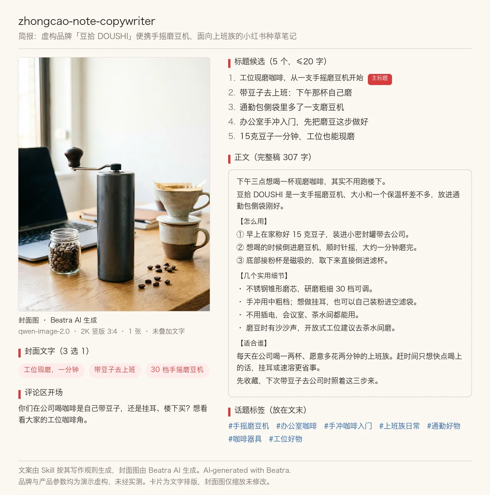

# 小红书文案 Skill

[简体中文](./README.md) | English

Turn a product, experience, topic, or audience brief into Xiaohongshu title options, a readable note body, cover text, hashtags, and a natural comment starter, from inside Claude Code, Codex, or OpenClaw.

> [!IMPORTANT]
> Rendering needs a [Beatra](https://beatra.ai) account and uses credits. The skill itself is free to install.

| Question | Answer |
| --- | --- |
| **What it does** | Turn a product, experience, topic, or audience brief into Xiaohongshu title options, a readable note body, cover text, hashtags, and a natural comment starter. |
| **Requirements** | Python 3.10+ and an agent that loads `SKILL.md` |
| **Cost** | Free to install. Each render uses credits on your Beatra account, and paid steps run only when you ask for that exact render or approve its card. |
| **Works with** | Claude Code, Codex, OpenClaw |

<p align="center"></p>

*Xiaohongshu note copy for a fictional portable coffee grinder, DOUSHI: the copy was written by the Skill and the cover photo was AI-generated with Beatra.*

| Skill | Entry point | Version |
| --- | --- | --- |
| [`zhongcao-note-copywriter`](skills/zhongcao-note-copywriter) | [SKILL.md](skills/zhongcao-note-copywriter/SKILL.md) | 0.2.4 |

This repository is published automatically from [beatra-ai/beatra-skills](https://github.com/beatra-ai/beatra-skills/tree/main/skills/zhongcao-note-copywriter). Report issues there.

## Install

With the [`skills`](https://skills.sh) CLI:

```bash
npx skills add beatra-ai/xiaohongshu-copywriter-skill
```

With the GitHub CLI:

```bash
gh skill install beatra-ai/xiaohongshu-copywriter-skill zhongcao-note-copywriter
```

Or clone this repository and copy `skills/zhongcao-note-copywriter` into `~/.claude/skills/` for Claude Code,
`~/.agents/skills/` for Codex, or `~/.openclaw/skills/` for OpenClaw.

Or paste this into your agent:

```text
Install the zhongcao-note-copywriter skill from https://github.com/beatra-ai/xiaohongshu-copywriter-skill (folder skills/zhongcao-note-copywriter), then follow its SKILL.md to connect my Beatra account.
```

## Specs

As of 2026-10-16. Live list: https://docs.beatra.ai/en/docs/models

- **Text to image** — 10 models (Qwen Image 2.0 Fast, Qwen Image 3.0, Qwen Image 3.0 Pro, GPT Image 2.5 Flare, GPT Image 2.5 Sunburst, GPT Image 2, Wan Image 2.7 Fast, Qwen Image 2.0 Pro, Wan Image 2.7 Pro, MiniMax Image 01 Live); up to 4 images per request; canvas up to 16777216 pixels

## What you get

- **Five titles, one chosen** — Compare five distinct openings written for the feed, take one as the primary title, and keep the rest for a second post.
- **A body with a real rhythm** — Short paragraphs, concrete details, and a save-worthy takeaway, written in the voice you asked for rather than in template language.
- **Claims stay yours** — Prices, results, credentials, and personal experience come from you, and the copy is screened so nothing lands that your account cannot stand behind.

## Use cases

- **Product recommendations** — Write a recommendation around what the product actually does for a specific reader, with the details that make it believable.
- **Experience and visit posts** — Turn a visit, a class, a trip, or a meal into a first-person note with the practical details a reader needs to go themselves.
- **Guides and knowledge notes** — Structure a how-to or comparison so the useful part arrives early and the note stays worth saving.
- **Local discovery** — Introduce a shop, studio, or place with the address-level details and the reason to make the trip.
- **Copy for an image set you already have** — Write the text layer for covers and carousels you produced elsewhere, so the words and the pictures tell the same story.

## FAQ

### Can I start from just a topic?

Yes. A topic is enough to draft from; naming the reader and the takeaway sharpens the note around them.

### Can I keep exact wording?

Yes. Mark a brand phrase, product name, or required line as must-keep and it appears in the copy exactly as written.

### Where do product claims come from?

From you. Prices, results, credentials, and personal experience are written from the facts you supply, and a missing one comes back as a question.

### Can I write in another language?

Yes. Name the language and the note is written in it, keeping the same structure and the same length discipline.

## Updates and security

Since the 2026-10 release, this skill contains no self-updater: it runs only the
files you installed and never replaces them on its own. Update it with the tool
you installed it with — `npx skills update zhongcao-note-copywriter` or `gh skill update zhongcao-note-copywriter`.
Details: `references/updates-and-security.md` inside the skill.

## License

[MIT-0](LICENSE) — free to use, modify, and redistribute, including
commercially. No attribution required. Same terms as these skills carry on
ClawHub.

## Links

- Website — https://beatra.ai
- Docs — https://docs.beatra.ai
- Console — https://console.beatra.ai
